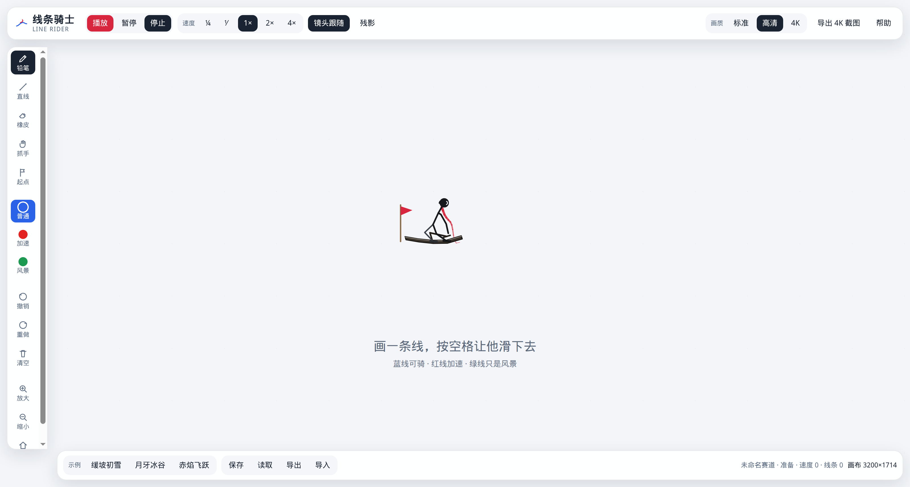
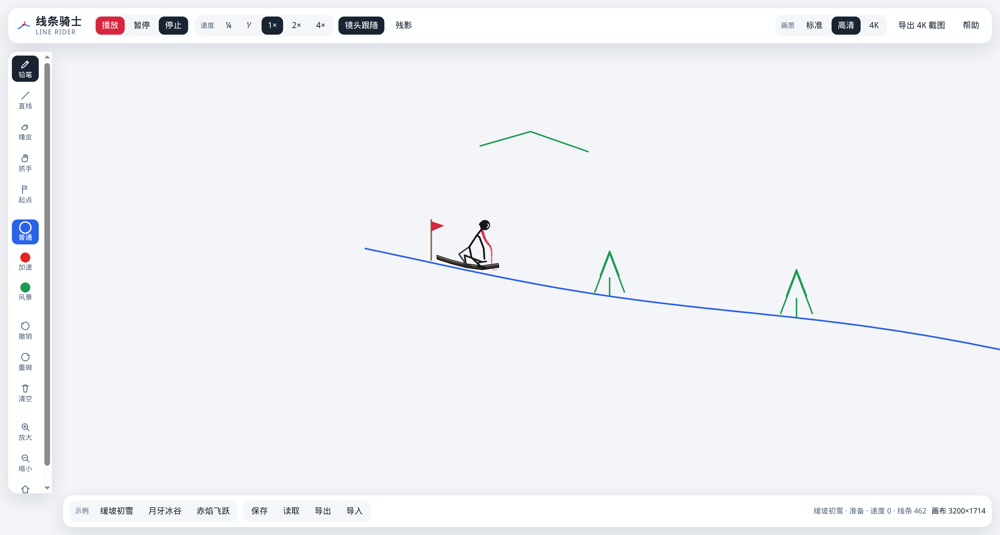
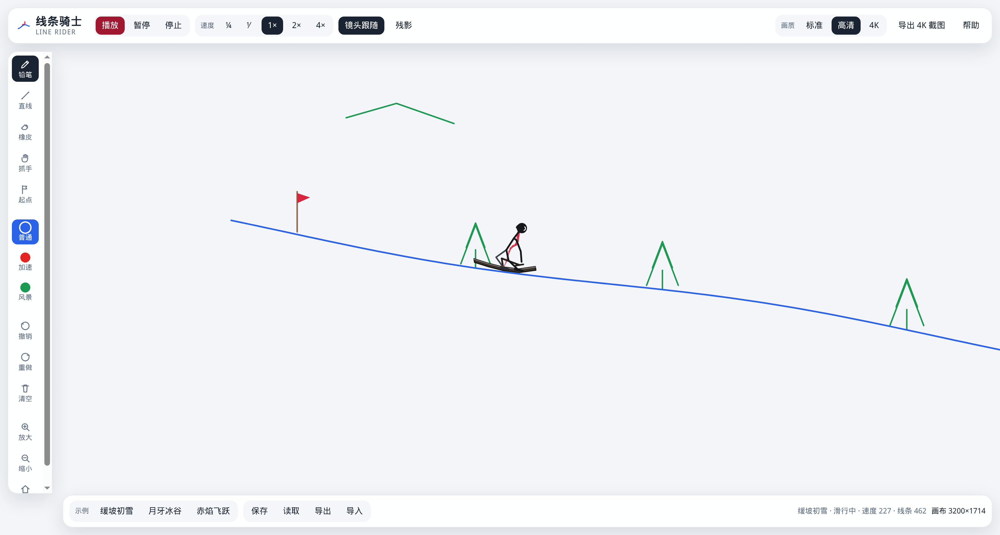
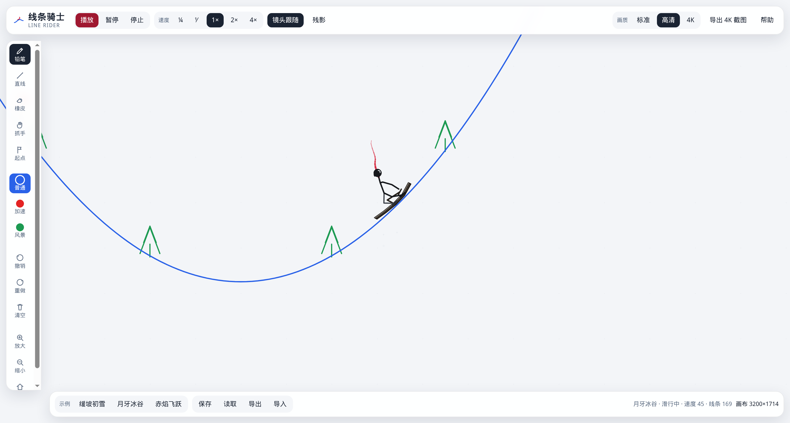
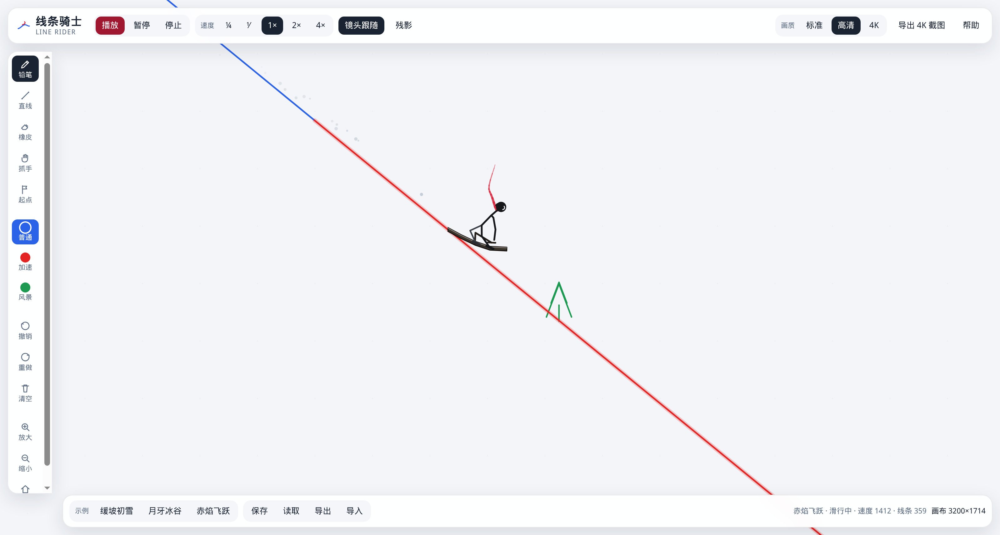
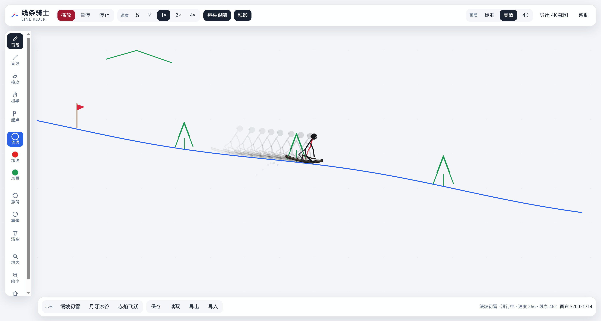

# 线条骑士

在浏览器里画线，让雪橇骑士滑下去。这是经典游戏 Line Rider 的非官方复刻，只在本地运行，没有服务器。

蓝线能骑，红线会顺着前进方向加速，绿线只是风景、不会挡住人。雪橇和骑士用 Verlet 质点加连杆来算：平时他坐在雪橇上，围巾在后面飘；撞得太狠，或者雪橇翻过去，他会从雪橇上摔下来，四肢散开。

## 在线试玩

[https://zhangjianlin0316-stack.github.io/line-rider/](https://zhangjianlin0316-stack.github.io/line-rider/)

仓库推到 `main` 之后，由 GitHub Actions 发布到 GitHub Pages。Pages 的来源需要选 **GitHub Actions**。

## 截图

开始的时候画布是空的，骑士等在起点旗旁边。



示例赛道「缓坡初雪」。



按下播放，镜头跟着他滑。



「月牙冰谷」会让他来回荡。



「赤焰飞跃」先跳上陡坡，再被红线加速。



打开「残影」可以看到刚才走过的位置。



上面这些图是在 2 倍像素比下截的，大约 3200×1714。

## 操作

| 动作 | 怎么做 |
| --- | --- |
| 铅笔 / 直线 / 橡皮 / 抓手 / 起点 | 左侧工具，或按 B / L / E / H / F |
| 普通线、加速线、风景线 | 按 1 / 2 / 3 |
| 播放、暂停 | 空格。按住空格再拖动可以平移画面 |
| 停止，回到起点 | Esc |
| 缩放 | 滚轮，或左侧放大、缩小。起点工具下滚轮改为旋转出发方向 |
| 水平或垂直直线 | 画直线时按住 Shift |
| 慢放、快进 | 顶栏的 ¼、½、1×、2×、4×，或按 `[` `]` |
| 镜头跟随、残影 | 顶栏按钮，或按 C / G |
| 撤销、重做 | Ctrl+Z、Ctrl+Y |
| 平移 | 抓手、鼠标中键，或按住空格拖动 |
| 触摸 | 单指画线，双指缩放和平移 |

播放的时候也可以接着画。新画的线马上就能骑。

## 画质

画布的后备缓冲区会跟着 `devicePixelRatio` 走，在 Retina 和 4K 屏幕上按物理像素绘制，线条和人物是带抗锯齿的矢量。

- **标准**：和屏幕物理像素 1:1
- **高清**：至少满物理像素；窗口不大时会再超采样一点
- **4K**：把画布往 3840×2160 超采样（总像素不超过 3840×2160）

「导出 4K 截图」会把当前画面用矢量重新画成一张 3840×2160 的 PNG，不是把屏幕截图放大。

## 存档和示例

- **保存 / 读取**存在这台浏览器的 localStorage 里，刷新还在。当前赛道也会自动存一份。
- **导出 / 导入**是 JSON 文件，可以换电脑接着画。
- 底栏有三条示例：**缓坡初雪**、**月牙冰谷**、**赤焰飞跃**。

## 本地运行

需要一个静态文件服务器。直接双击 `index.html` 打不开，因为脚本是 ES module。

```bash
python3 -m http.server 8000
```

然后打开 [http://127.0.0.1:8000/](http://127.0.0.1:8000/)。

物理相关的检查：

```bash
node tests/physics.test.mjs
```

## 发布

`.github/workflows/pages.yml` 会在推送到 `main` 时用 `actions/configure-pages`、`actions/upload-pages-artifact` 和 `actions/deploy-pages` 部署整个静态站点。仓库根目录有 `.nojekyll`。
